# iMOD5 executable versus Repository implementation

Reference edges come from actual iMOD5 executable GENSNAPTOGRID output, not a Python port. Candidate edges come from this repository's public snap_gen_to_grid implementation. Both use the same serialized GEN input (six decimal places) and grid. Results compare combined unique geometric walls, NOT per-feature assignments. Direction, attributes, row order and 3D output are not assessed. Dense random samples can hide per-feature differences. These are synthetic examples, not hydrological validation. Random perturbations use seed 43; tie-heavy inputs use seed 42. Random feature 97 is run in isolation, so iMOD5's final-feature rules apply to it.

[Self-contained HTML gallery](known_differences.html) | [Measured data](results.json)

Missing = executable-only; added = candidate-only. 15 of 48 cases differ from the executable, and each of them is drawn under Figures. A library error is reported explicitly, never counted as a successful empty result.

Blue: iMOD5 executable. Orange: Repository implementation. Difference panel: red = executable-only, purple = candidate-only, grey = shared.

## Measured results

| Case | iMOD5 executable walls | Repository implementation walls | Missing | Added |
|---|---:|---:|---:|---:|
| horizontal | 4 | 4 | 0 | 0 |
| vertical | 4 | 4 | 0 | 0 |
| diagonal-short | 4 | 4 | 0 | 0 |
| diagonal-full | 6 | 6 | 0 | 0 |
| through-nodes | 4 | 4 | 0 | 0 |
| shallow-slope | 4 | 4 | 0 | 0 |
| polyline | 5 | 4 | 1 | 0 |
| crossing-window | 4 | 4 | 0 | 0 |
| reentering | 6 | 6 | 0 | 0 |
| along-gridline | 4 | 4 | 0 | 0 |
| domain-boundary | 0 | 0 | 0 | 0 |
| boundary-right | 0 | 0 | 0 | 0 |
| boundary-then-inside | 2 | 2 | 0 | 0 |
| short-in-cell | 0 | 0 | 0 | 0 |
| outside | 0 | 0 | 0 | 0 |
| two-lines-same-edge | 4 | 4 | 0 | 0 |
| end-before-centre | 3 | 2 | 1 | 0 |
| end-after-centre | 3 | 3 | 0 | 0 |
| start-before-centre | 3 | 3 | 0 | 0 |
| reversed-end-before-centre | 2 | 2 | 0 | 0 |
| end-x-before-centre | 3 | 2 | 1 | 0 |
| slanted-end-before-centre | 3 | 2 | 1 | 0 |
| first-feature-end-not-extended | 6 | 6 | 0 | 0 |
| last-feature-end-extended | 7 | 6 | 1 | 0 |
| last-feature-outside-ignored | 3 | 2 | 1 | 0 |
| last-feature-in-single-cell | 2 | 2 | 0 | 0 |
| last-feature-one-piece-other-cell | 2 | 4 | 0 | 2 |
| tie-diagonal | 1 | 4 | 0 | 3 |
| on-half-cell-vertical | 3 | 0 | 3 | 0 |
| on-half-cell-diagonal | 6 | 6 | 0 | 0 |
| on-node-then-half-cell | 5 | 5 | 2 | 2 |
| duplicate-vertices | 4 | 4 | 0 | 0 |
| duplicate-end-vertices | 2 | 2 | 0 | 0 |
| last-feature-duplicate-points | 2 | 2 | 0 | 0 |
| leave-and-reenter-top | 9 | 3 | 7 | 1 |
| start-outside-diagonal | 4 | 4 | 0 | 0 |
| idffile-grid | 4 | 4 | 0 | 0 |
| idffile-window | 2 | 2 | 0 | 0 |
| nonuniform-horizontal | 6 | 6 | 0 | 0 |
| nonuniform-diagonal | 9 | 9 | 3 | 3 |
| nonuniform-polyline | 9 | 9 | 1 | 1 |
| nonuniform-leaving | 10 | 10 | 1 | 1 |
| random-ties | 264 | 264 | 0 | 0 |
| random-perturbed | 264 | 264 | 0 | 0 |
| random-feature-97 | 20 | 21 | 0 | 1 |
| large-meanders-42 | 17962 | 17962 | 0 | 0 |
| large-meanders-7 | 23292 | 23292 | 0 | 0 |
| large-meanders-2026 | 15974 | 15974 | 0 | 0 |

## Figures

### polyline

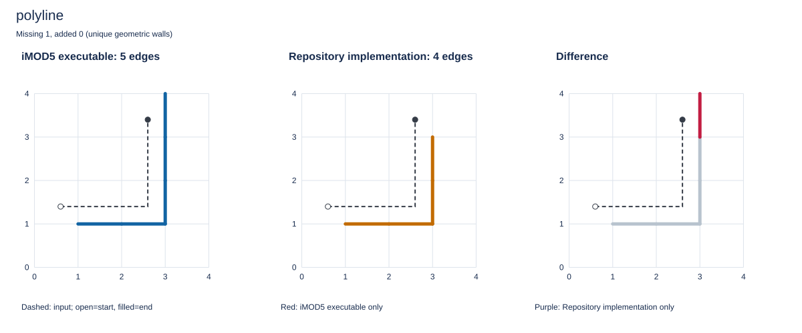

### end-before-centre

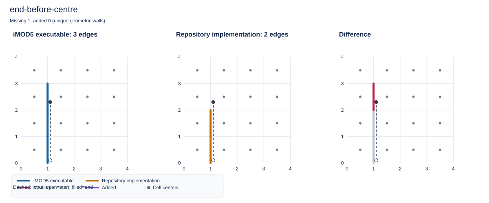

### end-x-before-centre

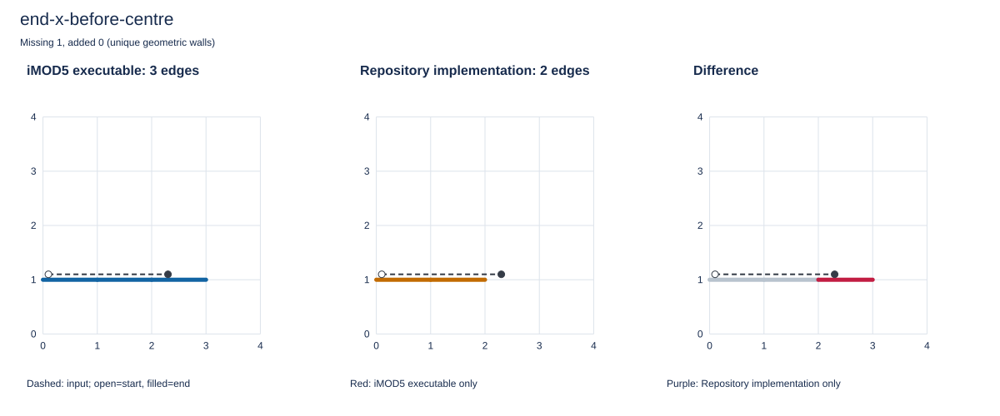

### slanted-end-before-centre

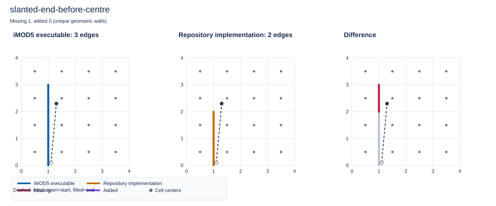

### last-feature-end-extended

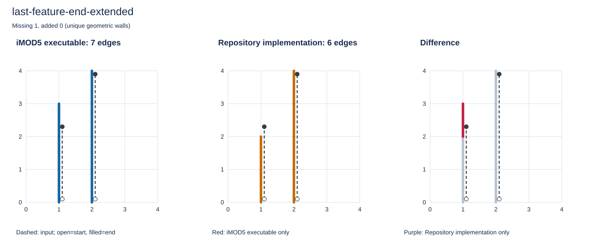

### last-feature-outside-ignored

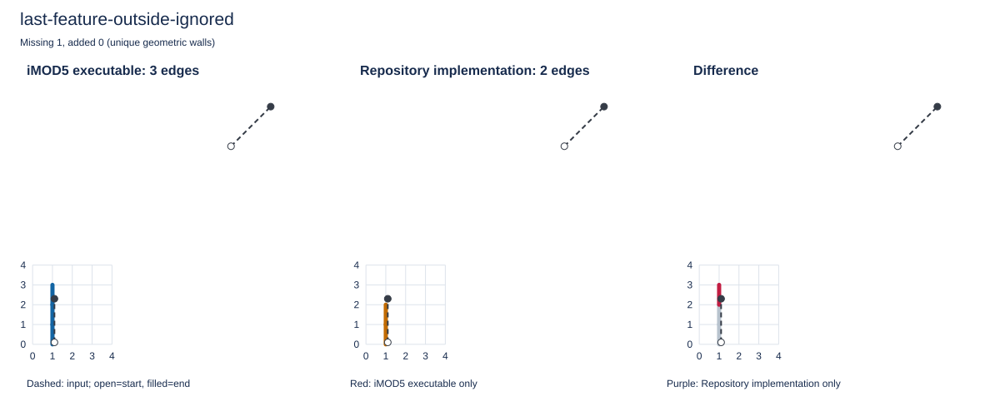

### last-feature-one-piece-other-cell

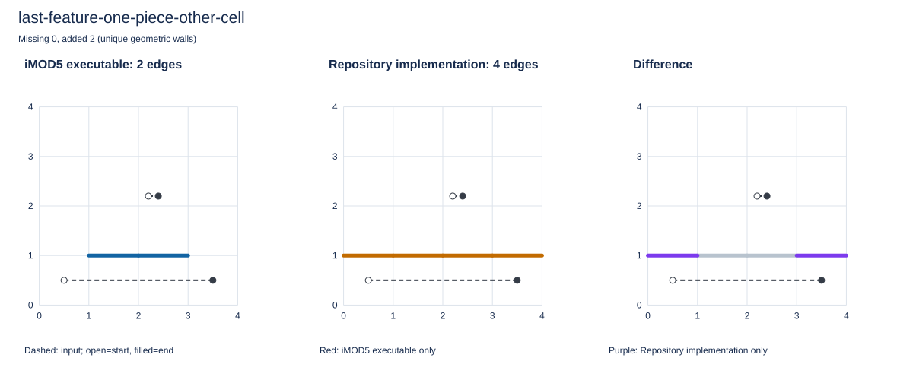

### tie-diagonal

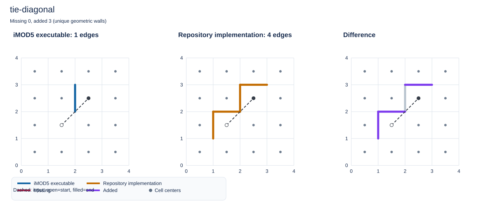

### on-half-cell-vertical

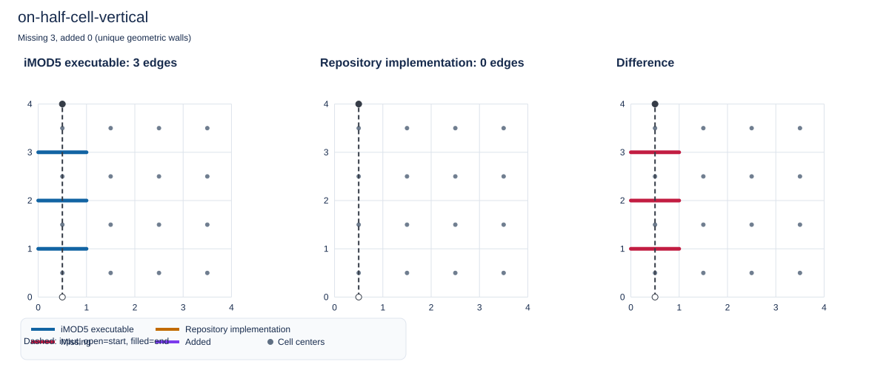

### on-node-then-half-cell

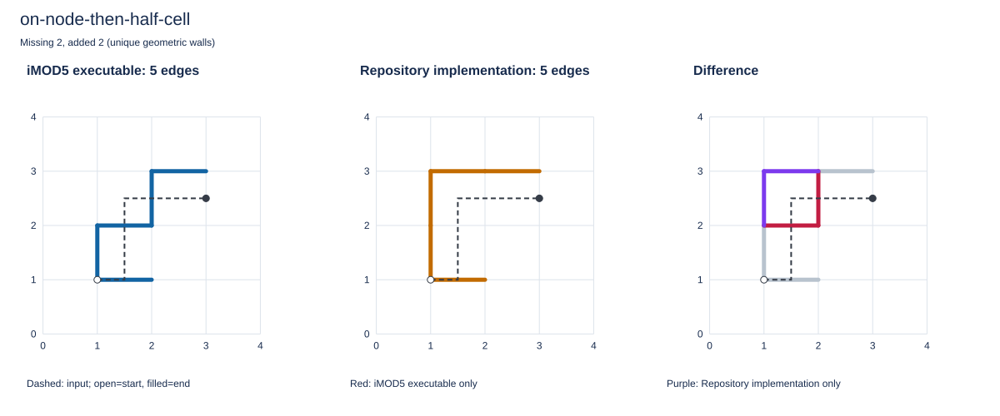

### leave-and-reenter-top

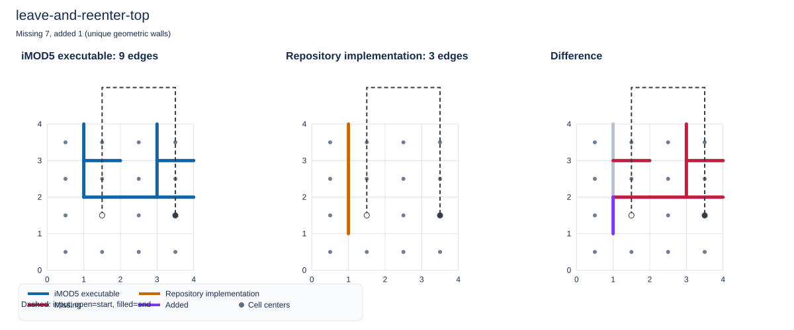

### nonuniform-diagonal

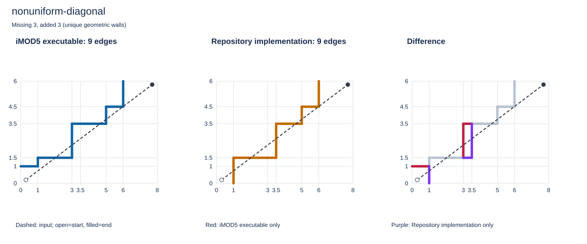

### nonuniform-polyline

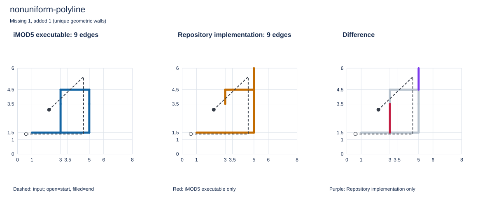

### nonuniform-leaving

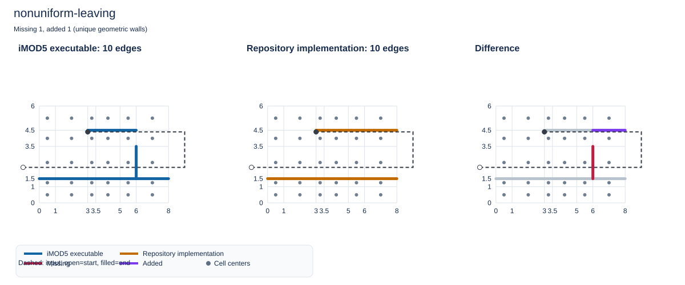

### random-feature-97

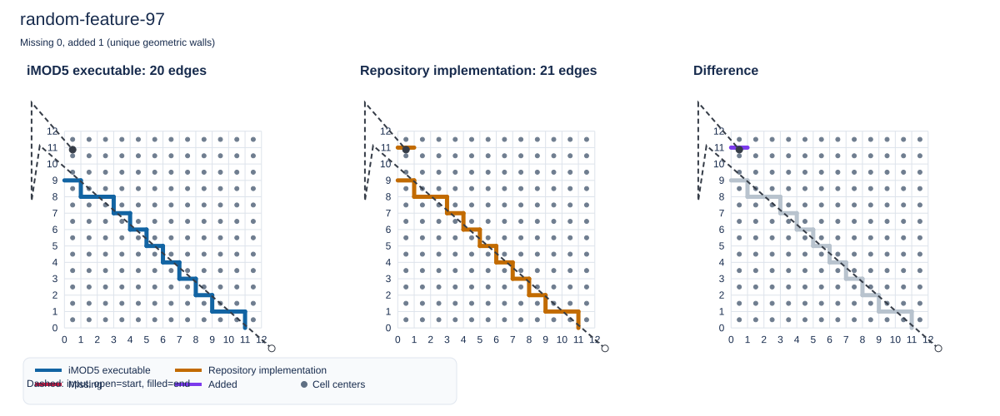

## Versions and provenance

```json
{
  "reference": "Actual iMOD5 executable (GENSNAPTOGRID)",
  "executable": "C:\\Development\\bin\\iMOD5\\iMOD 5.6.1\\iMOD_V5_6_1.exe",
  "python": "3.13.18",
  "xugrid": "0.15.3",
  "imod": "1.1.0"
}
```

The main repository comparison is rebuilt with `pixi run compare-grid-snapping`.
The separate `default_xugrid` report is a one-off snapshot and is not updated by that task.
